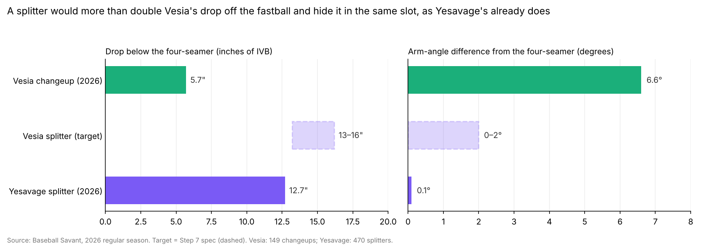
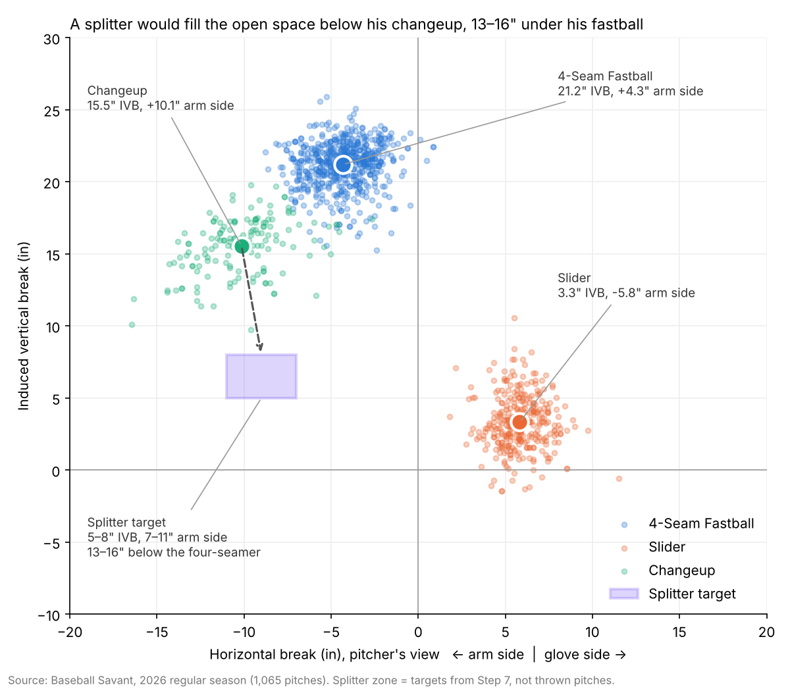
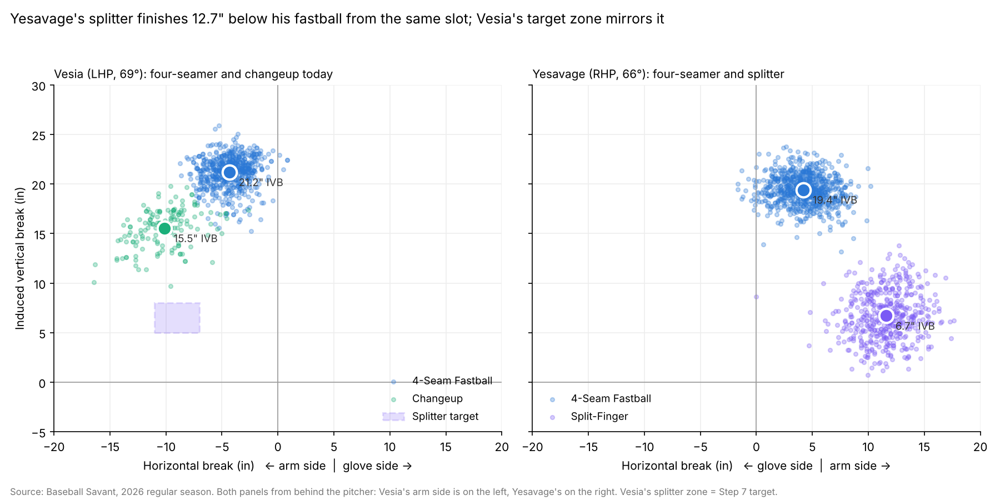

# Alex Vesia: Splitter Pitch Design

A pitch design case built from 2026 Statcast data: should a high-slot reliever replace his changeup with a splitter thrown from his fastball slot?



## TL;DR

| | |
|---|---|
| **Question** | Should Alex Vesia replace his changeup with a vertical splitter thrown from his fastball slot? |
| **Answer** | Yes. His changeup finishes only 5.7" below his four-seamer in induced vertical break (IVB) and leaves his hand 6.6° lower and almost 5" wider, so it neither drops away from the fastball nor hides behind it. |
| **The spec** | 82.5–84 mph, 1,250–1,450 rpm, 5–8" of IVB, 7–11" of arm-side run, released within 2° of his fastball's 69° arm angle. That pitch would finish 13–16" below the four-seamer. |
| **The proof** | Trey Yesavage, the full-season splitter pitcher with the slot closest to Vesia's (66°), already throws it: 12.7" below his fastball, from a slot 0.1° away, with a 38.8% whiff rate over 470 pitches. |

## Why this project

Vesia is a left-handed reliever built on an elite riding four-seamer: 92.1 mph with 21.2" of IVB, thrown from a 69.5° arm angle, the highest of any pitcher in the 2026 arm-angle leaderboard. His slider breaks the other way. His changeup is supposed to be the pitch that moves away from the fastball on the arm side, but it spins with 99% efficiency and keeps 15.5" of rise, so it plays like a slower fastball.

I wanted to answer the question a pitch design group asks before an off-season: does this pitcher's arsenal have a hole, and what pitch, built to fit his hand and his slot, would fill it? Because Vesia doesn't throw a splitter, the answer had to come from a specification checked against the league and against a real pitcher who throws that pitch from a similar slot.

What surprised me most was that the changeup's problem wasn't only its shape. It also comes out of a different window than the fastball, about 5 inches further toward his arm side. The splitter has to fix both.

## Approach

The full analysis is in [`notebooks/vesia_splitter.ipynb`](notebooks/vesia_splitter.ipynb), in 10 steps.

| Step | Question | What I did |
|---|---|---|
| 1–2 | Can I trust the data? | Loaded 1,078 rows of 2026 Statcast data. Removed 13 non-pitches (three intentional walks and a pitch-clock violation), checked ranges, and added IVB, arm-side break and vertical approach angle (VAA). |
| 3 | What does his arsenal look like? | Built a profile of every pitch (velocity, spin, spin direction, active spin, IVB, arm-side break, arm angle, VAA, whiff %, xwOBA) and a movement chart from behind the pitcher. |
| 4–5 | What's wrong with the changeup? | Measured its gaps from the four-seamer (5.7" of IVB, 2.3° of VAA) and its release: 6.6° lower arm angle, about 2.4 times the normal throw-to-throw variation, holding against both batter sides. |
| 6 | What does a good splitter look like? | Benchmarked 59 MLB splitters (100+ pitches). Compared the 10 thrown from slots of 50° or higher and checked which traits go with whiffs: speed gap from the fastball (−0.52), low spin (−0.40), moderate run (−0.34). |
| 7–8 | What should his splitter be? | Wrote a spec where every target is tied to a number, and drew it as a target zone on his movement chart. |
| 9–10 | Would it work? | Compared his changeup today, the splitter target and Yesavage's real splitter side by side. |



## Findings

### The comparison

| Gap from the four-seamer | Vesia changeup (now) | Vesia splitter (target) | Yesavage splitter (2026) |
|---|---|---|---|
| Velocity gap (mph) | −9.3 | −8 to −9.5 | −11.3 |
| IVB gap (in) | −5.7 | −13 to −16 | −12.7 |
| Arm-side break (in) | 10.1 | 7 to 11 | 11.6 |
| Arm angle gap (°) | −6.6 | within ±2 | 0.1 |
| Release side gap (in) | 4.9 | within 1–2 | 1.0 |
| VAA gap (°) | −2.3 | steeper | −3.2 |
| Whiff % | 44.0 | 38.1 or higher | 38.8 |
| xwOBA | .231 | .233 or lower | .248 |
| Pitches | 149 | — | 470 |

### What the data shows

- **The changeup separates by speed, not movement.** It is 9.3 mph slower than the four-seamer but only 5.7" lower. His slider, by comparison, finishes 17.9" lower.
- **The changeup has a release tell.** It comes out 6.6° lower and about 5" further toward his arm side, at almost the same height. The difference is sideways, and it holds against right-handed hitters, who see 144 of his 149 changeups.
- **High-slot splitters keep more rise.** The 10 high-slot splitters have a median of 4.9" of IVB against 2.2" for the rest, and their rise depends heavily on spin (0.84). The three pitchers with slots closest to Vesia's keep 6.7–8.4" at 1,300–1,450 rpm, which is why the target is 5–8", not the league's 2".
- **The changeup's good results rest on a small sample.** A 44.0% whiff rate and .231 xwOBA over 75 swings is promising, but the pitch's shape and release make it fragile over a full season. Yesavage's splitter gets similar results over 470 pitches from a pitch built on a real drop and a hidden release.



## Limitations

- **The splitter is a target, not a thrown pitch.** Its shape and results are estimates from comparable pitchers, not measurements.
- **Yesavage is a model, not a copy.** He is right-handed, throws about 2 mph harder, releases the ball about a foot higher, and most of his 2026 pitches came between May and July.
- **Small samples.** Vesia's changeup: 149 pitches and 75 swings. High-slot splitters: 10 pitchers.
- **Correlation isn't causation.** The traits tied to whiffs describe patterns across 59 pitchers, not what would happen for every pitcher.
- **What public data can't see.** Active spin is Savant's estimate, and the project can't account for grip, finger pressure, health or how comfortable Vesia would be learning a new pitch.

## Skills shown

- Data cleaning and validation (identifying intentional walks and pitch-clock violations in the raw data)
- Feature engineering: IVB and horizontal break in inches, arm-side normalization across handedness, vertical approach angle from release kinematics
- Merging pitch-level data with four Savant leaderboards
- Benchmarking with percentiles, group comparisons and correlation, and checking my own statistic when it was too sensitive to one pitch
- Data visualization in Matplotlib: movement charts from the pitcher's view, distributions, target zones and multi-panel comparisons
- Turning analysis into a pitch specification with measurable targets and a real-world comparison

**Tools:** Python, pandas, NumPy, Matplotlib, Jupyter, Baseball Savant (Statcast)

## How to run it

1. Install Python 3.10+ and the packages:

   ```bash
   pip install pandas numpy matplotlib jupyter
   ```

2. Clone the repository:

   ```bash
   git clone https://github.com/OmarMorillo/vesia-splitter-design.git
   cd vesia-splitter-design
   ```

3. Open `notebooks/vesia_splitter.ipynb` and run all cells. The raw data is in `data/raw/` (sources in [`data/raw/SOURCES.md`](data/raw/SOURCES.md)). The notebook writes the clean file to `data/clean/` and charts to `outputs/charts/`.

## Repository structure

```text
vesia-splitter-design/
├── README.md
├── data_dictionary.md        # every column used: meaning, units, source
├── data/
│   ├── raw/                  # Baseball Savant downloads, unchanged
│   └── clean/                # written by the notebook
├── notebooks/
│   └── vesia_splitter.ipynb  # the full analysis, Steps 1–10
└── outputs/
    └── charts/               # every chart in the notebook
```

**Data:** Baseball Savant, MLB Advanced Media (baseballsavant.mlb.com). 2026 regular season.

## About me

**Omar Morillo Aldana.** Former college player formed in Venezuelan baseball, Driveline-certified hitting coach, and M.S. Information Systems student at Point Park University. I'm learning to combine what the numbers say with how the body actually throws and swings.

[GitHub](https://github.com/OmarMorillo) · [LinkedIn](https://www.linkedin.com/in/omar-morillo-203a9124a/) · Morilloaldanaomar@gmail.com

---

## Resumen en español

**Alex Vesia: diseño de un splitter**

**La pregunta:** ¿debería Alex Vesia reemplazar su cambio de velocidad por un splitter vertical lanzado desde el mismo ángulo de brazo que su recta?

**La respuesta:** sí. Su cambio termina solo 5.7 pulgadas por debajo de su recta en quiebre vertical inducido y sale de la mano 6.6° más abajo y casi 5 pulgadas más hacia el lado del brazo. No cae lo suficiente para separarse de la recta y tampoco se esconde detrás de ella.

**La propuesta:** un splitter de 82.5 a 84 mph, con 1,250 a 1,450 rpm de giro, 5 a 8 pulgadas de quiebre vertical inducido y 7 a 11 pulgadas de movimiento hacia el lado del brazo, lanzado a menos de 2° del ángulo de brazo de su recta (69°). Ese lanzamiento terminaría entre 13 y 16 pulgadas por debajo de la recta.

**La prueba:** Trey Yesavage, el lanzador con un año completo de splitters cuyo ángulo de brazo (66°) es el más parecido al de Vesia, ya lanza ese pitcheo: 12.7 pulgadas por debajo de su recta, desde un ángulo a solo 0.1° de distancia, con 38.8% de swings fallados en 470 lanzamientos.

**Lo que muestran los datos:**

- El cambio se separa de la recta por velocidad, no por movimiento: es 9.3 mph más lento pero solo 5.7 pulgadas más bajo.
- El cambio delata el lanzamiento: sale 6.6° más abajo y unas 5 pulgadas más hacia el lado del brazo, algo que un bateador puede ver.
- Los splitters lanzados desde ángulos altos mantienen más subida (4.9 pulgadas contra 2.2), por eso la meta para Vesia es de 5 a 8 pulgadas.
- Los buenos números del cambio vienen de una muestra pequeña (75 swings); el splitter de Yesavage logra resultados parecidos en 470 lanzamientos.

**Sobre mí:** exjugador universitario formado en el béisbol venezolano, entrenador de bateo certificado por Driveline y estudiante de la maestría en Sistemas de Información en Point Park University. Estoy aprendiendo a combinar lo que dicen los números con cómo el cuerpo realmente lanza y batea.
