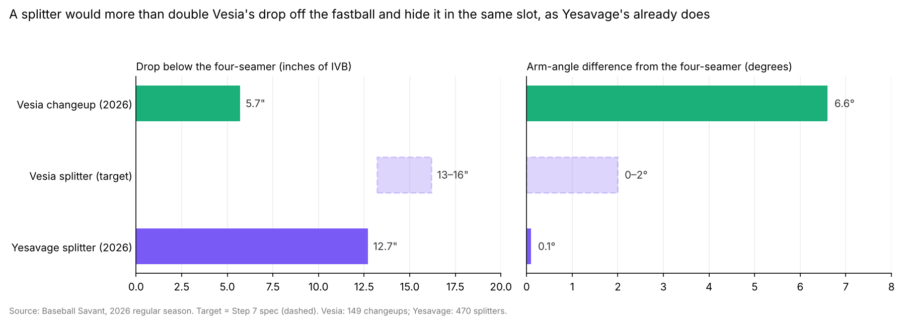
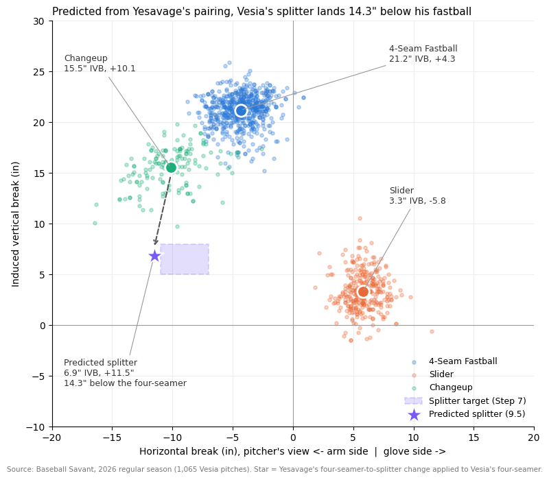

# Alex Vesia: Splitter Pitch Design

A pitch design case study built on 2026 Statcast data: should a high-slot reliever replace his changeup with a splitter thrown from his fastball slot?



## TL;DR

| | |
|---|---|
| **Question** | Should Alex Vesia replace his changeup with a vertical splitter thrown from his fastball slot? |
| **Answer** | Yes, as an off-season development project. His changeup finishes only 5.7" below his four-seamer in induced vertical break (IVB) and leaves his hand 6.6 degrees lower and about 5" further toward his arm side, so it neither drops away from the fastball nor hides behind it. |
| **Specification** | 82.5–84 mph, 1,250–1,450 rpm, 5–8" of IVB and 7–11" of arm-side run, released within 2 degrees of his fastball's 69-degree arm angle. That pitch would finish 13–16" below the four-seamer. |
| **Evidence** | Trey Yesavage, the full-season splitter pitcher whose arm slot (66 degrees) is closest to Vesia's, already throws this pitch: 12.7" below his fastball, from a slot 0.1 degrees away, with a 38.8% whiff rate over 470 splitters. |
| **Cross-check** | Applying Yesavage's four-seamer-to-splitter movement change to Vesia's four-seamer predicts 6.9" of IVB and 11.5" of arm-side run, 14.3" below his fastball: the same pitch the specification describes, reached by a second method. |

## Why this project

Vesia is a left-handed reliever built on an elite riding four-seamer: 92.1 mph with 21.2" of IVB, thrown from a 69.5-degree season arm angle, the highest in the 2026 arm-angle leaderboard. His slider breaks the other way. His changeup is supposed to be the pitch that moves away from the fastball on the arm side, but it spins with 99% efficiency and keeps 15.5" of rise, so it plays like a slower fastball.

I wanted to answer the question a pitch design group asks before an off-season: does this pitcher's arsenal have a hole, and what pitch, built to fit his slot and his spin, would fill it? Because Vesia doesn't throw a splitter, the answer had to come from a specification checked against the league and against a real pitcher who throws that pitch from a similar slot.

What surprised me most was that the changeup's problem isn't only its shape. It also comes out of a different window than the fastball, about 5" further toward his arm side. The splitter has to fix both.

## Approach

The full analysis is in [`notebooks/vesia_splitter.ipynb`](notebooks/vesia_splitter.ipynb), in 10 steps.

| Step | Question | What I did |
|---|---|---|
| 1–2 | Can I trust the data? | Loaded 1,078 rows of 2026 Statcast data, removed 13 non-pitches (three intentional walks and a pitch-clock violation), checked value ranges, and added IVB, arm-side break and vertical approach angle (VAA). |
| 3 | What does his arsenal look like? | Profiled every pitch (velocity, spin, spin direction, active spin, IVB, arm-side break, arm angle, VAA, whiff rate, xwOBA) and plotted his movement from the pitcher's view. |
| 4–5 | What's wrong with the changeup? | Measured its gaps from the four-seamer (5.7" of IVB, 2.3 degrees of VAA) and its release: a 6.6-degree lower arm angle, about 2.4 times the normal throw-to-throw variation, consistent against hitters on both sides. |
| 6 | What does a good splitter look like? | Benchmarked the 59 MLB pitchers with 100+ splitters, compared the 10 who throw from a 50-degree slot or higher, and measured which traits go with whiffs. |
| 7–8 | What should his splitter be? | Wrote a specification in which every target is tied to a number from the data, and drew it as a target zone on his movement chart. |
| 9 | Would it work? | Compared his changeup, the splitter target and Yesavage's splitter, then predicted Vesia's splitter by measuring each pitch's movement direction (`arctan2`) and applying Yesavage's four-seamer-to-splitter change to Vesia's four-seamer. |
| 10 | What's the story? | Summarized the case in one chart: drop below the fastball and arm-angle difference for the changeup, the target and Yesavage's splitter. |

## Findings

### The comparison

| Measured against the pitcher's own four-seamer | Vesia changeup (2026) | Vesia splitter (target) | Yesavage splitter (2026) |
|---|---|---|---|
| Velocity gap (mph) | −9.3 | −8 to −9.5 | −11.3 |
| IVB gap (in) | −5.7 | −13 to −16 | −12.7 |
| Horizontal break (in) | 10.1 | 7 to 11 | 11.6 |
| Arm angle gap (degrees) | −6.6 | within ±2 | 0.1 |
| Release side gap (in) | 4.9 | within 1–2 | 1.0 |
| VAA gap (degrees) | −2.3 | steeper than −2.3 | −3.2 |
| Whiff rate (%) | 44.0 | 38.1 or higher | 38.8 |
| xwOBA | .231 | .233 or lower | .248 |
| Pitches | 149 | — | 470 |

### What the data shows

- **The changeup separates by speed, not movement.** It is 9.3 mph slower than the four-seamer but only 5.7" lower. His slider, by comparison, finishes 17.9" lower.
- **The changeup has a release tell.** It comes out 6.6 degrees lower and about 5" further toward his arm side, at almost the same height. The difference holds against right-handed hitters, who see 144 of his 149 changeups.
- **High-slot splitters keep more rise.** Splitters thrown from a 50-degree slot or higher have a median of 4.9" of IVB, against 2.2" for the rest of the league, and their rise tracks spin closely (a correlation of 0.84). The three pitchers whose slots are closest to Vesia's keep 6.7–8.4" at about 1,300–1,440 rpm, which is why the target is 5–8" rather than the league median of 2.3".
- **What goes with whiffs.** Across the 59 splitters, the strongest links to a higher whiff rate are a larger speed gap below the fastball, lower spin and less arm-side run (correlations of −0.52, −0.40 and −0.34). Those three findings set the velocity, spin and run targets.
- **A second method lands on the same pitch.** Yesavage's splitter moves 47.8 degrees below the direction of his four-seamer. Applying that change to Vesia's four-seamer predicts a splitter with 6.9" of IVB and 11.5" of arm-side run, 14.3" below his fastball. The rise and the drop fall inside the specification, and the run is only 0.5" over it. Velocity is the one disagreement: Yesavage's 11.3 mph gap would put Vesia at 80.8 mph, while the high-slot median gap gives 83.4 mph, so the target stays at 82.5–84.
- **The changeup's strong results rest on a small sample.** Its 44.0% whiff rate comes from 75 swings and its .231 xwOBA from 35 plate appearances. Promising, but its shape and release make it fragile over a full season. Yesavage's splitter holds a 38.8% whiff rate and a .248 xwOBA over 470 pitches, from a pitch built on a real drop and a hidden release.



## Limitations

- **The splitter is a target, not a thrown pitch.** Its shape and results are estimates from comparable pitchers, not measurements.
- **Yesavage is a model, not a copy.** He is right-handed, throws about 2 mph harder, releases the ball about a foot higher, and threw most of his 2026 pitches between May and July.
- **The prediction rests on one pitcher.** It borrows Yesavage's total splitter movement and his direction change. More same-slot comparisons would turn the single point into a range.
- **Small samples.** Vesia's changeup: 149 pitches and 75 swings. High-slot splitters: 10 pitchers.
- **Correlation is not causation.** The traits tied to whiffs describe patterns across 59 pitchers, not what would happen for any one pitcher.
- **What public data can't see.** Active spin is Savant's estimate, and the project can't account for grip, finger pressure, health or how quickly Vesia could learn a new pitch.

## Skills shown

- Data cleaning and validation, including identifying intentional walks and pitch-clock violations in the raw data
- Feature engineering: IVB and horizontal break in inches, arm-side normalization across handedness, and vertical approach angle from release kinematics
- Merging pitch-level data with four Baseball Savant leaderboards
- Benchmarking with percentiles, group comparisons and correlation, including stress-testing my own statistic when it depended on a single pitch
- Pitch movement modeling with trigonometry: movement direction with `arctan2`, offsets from arm angle, and transferring a comparison pitcher's fastball-to-splitter change
- Data visualization in Matplotlib: movement charts from the pitcher's view, distributions, target zones and multi-panel summaries
- Turning analysis into a pitch specification with measurable targets and a real-world comparison

**Tools:** Python, pandas, NumPy, Matplotlib, Jupyter, Baseball Savant (Statcast)

## How to run it

1. Install Python 3.10+ and the packages:

   ```bash
   pip install pandas numpy matplotlib jupyter
   ```

2. Clone the repository:

   ```bash
   git clone https://github.com/OmarMorillo/vesia-splitter-design.git
   cd vesia-splitter-design
   ```

3. Open `notebooks/vesia_splitter.ipynb` and run all cells. The raw data is in `data/raw/` (sources in [`data/raw/SOURCES.md`](data/raw/SOURCES.md)). The notebook writes the clean file to `data/clean/` and charts to `outputs/charts/`.

## Repository structure

```text
vesia-splitter-design/
├── README.md
├── data_dictionary.md        # every column used: meaning, units, source
├── data/
│   ├── raw/                  # Baseball Savant downloads, unchanged
│   └── clean/                # written by the notebook
├── notebooks/
│   └── vesia_splitter.ipynb  # the full analysis, Steps 1–10
└── outputs/
    └── charts/               # charts saved by the notebook
```

**Data:** Baseball Savant, MLB Advanced Media (baseballsavant.mlb.com). 2026 regular season.

## About me

**Omar Morillo Aldana.** Former college baseball player who grew up playing in Venezuela, Driveline-certified hitting coach and pitch design student, and M.S. Information Systems student at Point Park University. I'm learning to combine what the numbers say with how the body actually throws and swings.

[GitHub](https://github.com/OmarMorillo) · [LinkedIn](https://www.linkedin.com/in/omar-morillo-203a9124a/) · Morilloaldanaomar@gmail.com

---

## Resumen en español

**Alex Vesia: diseño de un splitter**

**La pregunta:** ¿debería Alex Vesia reemplazar su cambio de velocidad por un splitter vertical lanzado desde el mismo ángulo de brazo que su recta?

**La respuesta:** sí, como proyecto de desarrollo para la temporada baja. Su cambio termina solo 5.7 pulgadas por debajo de su recta en quiebre vertical inducido (IVB) y sale de la mano 6.6 grados más abajo y unas 5 pulgadas más hacia el lado del brazo. No cae lo suficiente para separarse de la recta y tampoco se esconde detrás de ella.

**La propuesta:** un splitter de 82.5 a 84 mph, con 1,250 a 1,450 rpm de giro, 5 a 8 pulgadas de IVB y 7 a 11 pulgadas de movimiento hacia el lado del brazo, lanzado a menos de 2 grados del ángulo de brazo de su recta (69 grados). Ese lanzamiento terminaría entre 13 y 16 pulgadas por debajo de la recta.

**La evidencia:** Trey Yesavage, el lanzador con una temporada completa de splitters cuyo ángulo de brazo (66 grados) es el más parecido al de Vesia, ya lanza ese pitcheo: 12.7 pulgadas por debajo de su recta, desde un ángulo a solo 0.1 grados de distancia, con un 38.8% de swings fallados en 470 splitters.

**La verificación:** al aplicar a la recta de Vesia el cambio de movimiento que Yesavage hace de su recta a su splitter, el splitter previsto tiene 6.9 pulgadas de IVB y 11.5 pulgadas hacia el lado del brazo, 14.3 pulgadas por debajo de la recta: el mismo pitcheo de la propuesta, obtenido con un segundo método.

**Lo que muestran los datos:**

- El cambio se separa de la recta por velocidad, no por movimiento: es 9.3 mph más lento pero solo 5.7 pulgadas más bajo.
- El cambio delata el lanzamiento: sale 6.6 grados más abajo y unas 5 pulgadas más hacia el lado del brazo, algo que un bateador puede ver.
- Los splitters lanzados desde ángulos de 50 grados o más mantienen más subida (4.9 pulgadas contra 2.2), por eso la meta para Vesia es de 5 a 8 pulgadas.
- Los buenos números del cambio vienen de una muestra pequeña (75 swings); el splitter de Yesavage mantiene buenos resultados en 470 lanzamientos.

**Sobre mí:** exjugador universitario que creció jugando béisbol en Venezuela, entrenador de bateo certificado por Driveline, estudiante de diseño de pitcheos y de la maestría en Sistemas de Información en Point Park University. Estoy aprendiendo a combinar lo que dicen los números con cómo el cuerpo realmente lanza y batea.
